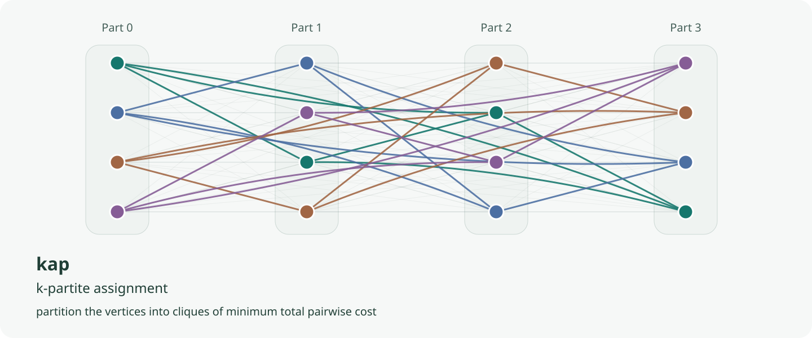

``kap``: $k$-Assignment Problem Solver
======
[](https://github.com/inspiros/kap/actions) [](https://pypi.org/project/kap) [](https://pepy.tech/project/kap) [](https://github.com/inspiros/kap/blob/master/LICENSE.txt) [](https://zenodo.org/badge/latestdoi/R_kgDOK5wdCQ)

This project implements **Boštjan Gabrovšek**'s Multiple Hungarian Methods for solving the **$k$-Assignment Problem**
(or **$k$-Partite Graph Matching Problem**), described in [this paper](https://www.mdpi.com/2227-7390/8/11/2050).

Since 0.3, all six algorithms and the Linear Assignment solver run in a native Rust core,
usable from Python (``kap``) and from Rust (crate [``kap-solver``](crates/kap-solver)).

## Background

### Problem Formulation

**$k$-Assignment (a.k.a. $k$-Partite Graph Matching) Problem** is the extension of **Linear Assignment
(Bipartite Graph Matching) Problem**.
It is also traditionally referred to as **Multidimensional Assignment Problem**.

<p align="center">
    
</p>

Formally, we seek a $k$-assignment of a given $k$-partite weighted graph $G = (V, E, \omega)$ with the minimum weight:

```math
\min{\sum\limits_{\mathcal{Q}}{\omega(\mathcal{Q})\ |\ \mathcal{Q}\text{ is a }k\text{-assignment in }G}}
```
where
```math
\omega(\mathcal{Q}) = \sum\limits_{e \in E(G[\mathcal{Q}])}{\omega(e)}
```

This repository provides the implementation of 6 algorithms proposed by Gabrovšek for solving this problem, 
which is decomposed into small binary sub-problems and tackled with using the Hungarian procedure.
While this means we can generalize for an arbitrary number $k$ and use different algorithms other than Hungarian,
the methods might not be the most efficient for certain cases (e.g. $k = 3$ a.k.a. the **3-index Assignment Problem**).

For more technical details, please refer to the [paper](https://www.mdpi.com/2227-7390/8/11/2050)
or contact the authors, not me 😂.

### Context

I implemented this code for testing an idea in another project.
After that, I decided to publish the code so that someone facing a similar problem can use.
Further maintenance or performance tuning might be limited, but all contribution is welcome.

## Requirements

- **Python 3.10+**
- ``numpy``
- optional: ``scipy``, ``lap``, ``lapjv`` or ``munkres``
  _(alternative backends for the Linear Assignment Problem; the native ``kap`` backend is built in)_

## Installation

Simply run the following command:

```
pip install kap
```

Prebuilt wheels (one abi3 wheel per platform, for all Python versions from 3.10) need no compiler.
Building from source needs a Rust toolchain, see [docs/installation.md](docs/installation.md).

Full documentation is in [docs](docs/index.md).

## Changes in 0.3

- **Native core.** ``kap.k_assignment`` and ``kap.linear_assignment`` run in Rust for the default
  ``backend="kap"``; the multiple Hungarian methods run up to about 110x faster than the Python
  implementation for small inputs, and 1.2-2x for large ones, where the LAP solves dominate
  ([benchmarks](docs/benchmarks.md)). $\text{F}_m$ is the exception: it now always runs
  ``max_iter`` steps, so it is slower for $k \geq 4$ but finds lower-cost solutions.
  Other backends still run the pure Python implementation.
- **Algorithms follow the paper.** $\text{C}_m$ is pure steepest descent, $\text{E}_m$ runs independent
  random trials, and $\text{F}_m$ is a tabu search that may take sideways or worse moves and returns the
  best solution found. $\text{A}_m$, $\text{B}_m$ and $\text{D}_m$ give the same results as 0.2.3,
  but $\text{C}_m$, $\text{E}_m$ and $\text{F}_m$ can return different (for $\text{F}_m$, usually lower-cost)
  solutions. For the same ``random_state``, $\text{E}_m$ and $\text{F}_m$ also draw different random
  sequences than in 0.2.
- **Removed** the ``lapsolver`` backend (it no longer builds on recent Python).
- **Python 3.10+** is required.

## Quick Start

### Solving Linear Assignment Problem

For convenience, we provide ``kap.linear_assignment`` as a wrapper around backend functions.
The available backends are:
- ``kap`` (default): built-in native solver (Jonker-Volgenant initialisation + shortest augmenting path,
  same results as ``scipy``); also available directly as ``kap.linear_sum_assignment``
- ``scipy``: [``scipy.optimize.linear_sum_assignment``'s documentation](https://docs.scipy.org/doc/scipy/reference/generated/scipy.optimize.linear_sum_assignment.html)
- ``lap``: https://github.com/gatagat/lap
- ``lapjv``: https://github.com/src-d/lapjv
- ``munkres``: https://github.com/bmc/munkres

Note that we currently do **NOT** support sparse matrix.
For a benchmark, please head to https://github.com/berhane/LAP-solvers.

The interface is unified as ``kap.linear_assignment`` returns a namedtuple of ``matches``,
``matching_costs`` of matched edges, and optionally a list of ``free``(or unmatched) vertices if called with
``return_free=True``.

```python
import numpy as np

from kap import linear_assignment

cost = np.array([
    [9, 6, 4],
    [4, 4, 6],
    [3, 9, 2]
])
matching_result = linear_assignment(cost, return_free=True)
print("Result:", matching_result)
# Result: AssignmentResult(matches=array([[0, 2],
#       [1, 1],
#       [2, 0]]), matching_costs=array([4, 4, 3]), free=[])
print("Total cost:", sum(matching_result.matching_costs))
# Total cost: 11
```

### Solving $k$-Assignment Problem

``kap.k_assignment`` is the equivalence for $k$-Assignment Problem.
There are a few things to note about its parameters:
- ``cost_matrices``: Sequence of $n (n - 1) / 2$ 2D cost matrices of pairwise matching costs between $n$ partites
  (might not be able to be represented as a 3D ``np.ndarray`` since partites can have different number of vertices)
  ordered as in ``itertools.combination(n, 2)``. For example, $[C_{01}, C_{02}, C_{03}, C_{12}, C_{13}, C_{23}]$.
- ``algo``: This should be one of the six proposed algorithms, namely ``"Am", "Bm", "Cm", "Dm", "Em", "Fm"``.
  $\text{C}_m$ is set to be the default as it usually performs as good as random approaches while having a
  deterministic behavior.
- ``max_iter``, ``n_trials``, ``random_state``: control $\text{C}_m$, $\text{E}_m$ and $\text{F}_m$;
  pass an int (or a seeded ``RandomState``/``Generator``) to ``random_state`` for reproducible results.

Its return type shares the same structure as that of ``kap.linear_assignment`` but with some small differences:
- ``matches``: Each element is the list of indices of matched vertices. For example, ``[(0, 0), (1, 1), (2, 0)]``
  indicates that node 0 of partite 0, node 1 of partite 1, and node 0 of partite 2 are matched together.
  Note that it is **NOT** necessary for a match to contain at least one vertex from each partite (incomplete graph).
- ``matching_costs``: Each element is the sum of pairwise costs of all edges formed by the matched vertices.

The following code reproduce the example described in the paper.

```python
import numpy as np

from kap import k_assignment

costs = [
    np.array([  # (0, 1)
        [9, 6, 4],
        [4, 4, 6],
        [3, 9, 2]
    ]),
    np.array([  # (0, 2)
        [8, 2, 9],
        [5, 0, 4],
        [8, 7, 4]
    ]),
    np.array([  # (1, 2)
        [4, 0, 9],
        [9, 9, 6],
        [8, 9, 5]
    ]),
]
matching_result = k_assignment(costs, algo="Em", return_free=True, random_state=0)
print("Result:", matching_result)
# Result: AssignmentResult(matches=[[(0, 0), (1, 1), (2, 0)], [(0, 1), (1, 0), (2, 1)], [(0, 2), (1, 2), (2, 2)]], matching_costs=[23, 4, 11], free=[])
print("Total cost:", sum(matching_result.matching_costs))
# Total cost: 38
```

These code blocks are extracted from [examples](examples).

## License

MIT licensed. See [LICENSE.txt](LICENSE.txt).
