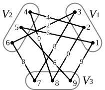

``kap``: $k$-Assignment Problem Solver
======
[](https://github.com/inspiros/kap/actions) [](https://pypi.org/project/kap) [](https://pepy.tech/project/kap) [](https://github.com/inspiros/kap/blob/master/LICENSE.txt) [](https://zenodo.org/badge/latestdoi/R_kgDOK5wdCQ)

This project implements **Boštjan Gabrovšek**'s Multiple Hungarian Methods for solving the **$k$-Assignment Problem**
(or **$k$-Partite Graph Matching Problem**), described in [this paper](https://www.mdpi.com/2227-7390/8/11/2050).

## Background

### Problem Formulation

**$k$-Assignment (a.k.a. $k$-Partite Graph Matching) Problem** is the extension of **Linear Assignment
(Bipartite Graph Matching) Problem**.
It is also traditionally referred to as **Multidimensional Assignment Problem**.

<p align="center">
    
</p>

Formally, we seek a $k$-assignment of a given $k$-partite weighted graph $G = (V, E, \omega)$ with the minimum weight:

```math
\min{\sum\limits_{\mathcal{Q}}{\omega(\mathcal{Q})\ |\ \mathcal{Q}\text{ is a }k\text{-assignment in }G}}
```
where
```math
\omega(\mathcal{Q}) = \sum\limits_{e \in E(G[\mathcal{Q}])}{\omega(e)}
```

This repository provides the implementation of 6 algorithms proposed by Gabrovšek for solving this problem, 
which is decomposed into small binary sub-problems and tackled with using the Hungarian procedure.
While this means we can generalize for an arbitrary number $k$ and use different algorithms other than Hungarian,
the methods might not be the most efficient for certain cases (e.g. $k = 3$ a.k.a. the **3-index Assignment Problem**).

For more technical details, please refer to the [paper](https://www.mdpi.com/2227-7390/8/11/2050)
or contact the authors, not me 😂.

### Context

I implemented this code for testing an idea in another project.
After that, I decided to publish the code so that someone facing a similar problem can use.
Further maintenance or performance tuning might be limited, but all contribution is welcome.

## Requirements

- **Python 3.9+**
- ``numpy``
- ``scipy`` (default backend) or ``lap`` or ``lapjv`` or ``lapsolver`` or ``munkres``
  _(depends on the backend to be used for solving Linear Assignment Problem)_

## Installation

Install with the default ``scipy`` backend:

```
pip install kap[scipy]
```

``pip install kap`` alone installs only ``numpy``; then install one of the backends above yourself
(extras ``kap[lap]``, ``kap[lapjv]`` and ``kap[munkres]`` are also available).

#### Notes

This is currently a pure Python project, but we may add Cython/C++ extension in the future.

## Quick Start

### Solving Linear Assignment Problem

For convenience, we provide ``kap.linear_assignment`` as a wrapper around backend functions.
The available backends are:
- ``scipy``: [``scipy.optimize.linear_sum_assignment``'s documentation](https://docs.scipy.org/doc/scipy/reference/generated/scipy.optimize.linear_sum_assignment.html)
- ``lap``: https://github.com/gatagat/lap
- ``lapjv``: https://github.com/src-d/lapjv
- ``lapsolver``: https://github.com/cheind/py-lapsolver
- ``munkres``: https://github.com/bmc/munkres

Note that we currently do **NOT** support sparse matrix.
For a benchmark, please head to https://github.com/berhane/LAP-solvers.

The interface is unified as ``kap.linear_assignment`` returns a namedtuple of ``matches``,
``matching_costs`` of matched edges, and optionally a list of ``free``(or unmatched) vertices if called with
``return_free=True``.

```python
import numpy as np

from kap import linear_assignment

cost = np.array([
    [9, 6, 4],
    [4, 4, 6],
    [3, 9, 2]
])
matching_result = linear_assignment(cost, return_free=True, backend="lap")
print("Result:", matching_result)
# Result: AssignmentResult(matches=array([[0, 2],
#       [1, 1],
#       [2, 0]]), matching_costs=array([4, 4, 3]), free=[])
print("Total cost:", sum(matching_result.matching_costs))
# Total cost: 11
```

### Solving $k$-Assignment Problem

``kap.k_assignment`` is the equivalence for $k$-Assignment Problem.
There are a few things to note about its parameters:
- ``cost_matrices``: Sequence of $k (k - 1) / 2$ 2D cost matrices of pairwise matching costs between $k$ partites
  (might not be able to be represented as a 3D ``np.ndarray`` since partites can have different number of vertices)
  ordered as in ``itertools.combinations(range(k), 2)``. For example, for $k = 4$:
  $[C_{01}, C_{02}, C_{03}, C_{12}, C_{13}, C_{23}]$.
- ``algo``: This should be one of the six proposed algorithms, namely ``"Am", "Bm", "Cm", "Dm", "Em", "Fm"``.
  $\text{C}_m$ is set to be the default as it usually performs as good as random approaches while having a
  deterministic behavior.

Its return type shares the same structure as that of ``kap.linear_assignment`` but with some small differences:
- ``matches``: Each element is the list of indices of matched vertices. For example, ``[(0, 0), (1, 1), (2, 0)]``
  indicates that node 0 of partite 0, node 1 of partite 1, and node 0 of partite 2 are matched together.
  Note that it is **NOT** necessary for a match to contain at least one vertex from each partite (incomplete graph).
- ``matching_costs``: Each element is the sum of pairwise costs of all edges formed by the matched vertices.

The following code reproduce the example described in the paper.

```python
import numpy as np

from kap import k_assignment

costs = [
    np.array([  # (0, 1)
        [9, 6, 4],
        [4, 4, 6],
        [3, 9, 2]
    ]),
    np.array([  # (0, 2)
        [8, 2, 9],
        [5, 0, 4],
        [8, 7, 4]
    ]),
    np.array([  # (1, 2)
        [4, 0, 9],
        [9, 9, 6],
        [8, 9, 5]
    ]),
]
matching_result = k_assignment(costs, algo="Em", return_free=True, backend="lap")
print("Result:", matching_result)
# Result: AssignmentResult(matches=[[(0, 0), (1, 1), (2, 0)], [(0, 1), (1, 0), (2, 1)], [(0, 2), (1, 2), (2, 2)]], matching_costs=[23, 4, 11], free=[])
# (with numpy >= 2, the costs print as numpy scalars: [np.int64(23), np.int64(4), np.int64(11)])
print("Total cost:", sum(matching_result.matching_costs))
# Total cost: 38
```

These code blocks are extracted from [examples](examples).

## Changes in 0.2.3

**Upgrade recommended**, and re-run any results computed with $k \geq 4$ partites:
- Fixed wrong costs for $k \geq 4$: the quotient graph read the cost matrices with the wrong indices,
  so the returned assignment could be suboptimal and the reported costs could even be lower than the true optimum.
- ``Em``: ``n_trials`` now runs independent trials from the ``Bm`` solution, as in the paper;
  before, it had no effect.
- ``Fm``: no longer runs to ``max_iter`` when it reaches a plateau; sideways moves must reach a different
  solution and cannot return to the previous one.
- ``Am``/``Bm``: an internal argument was passed into the wrong parameter of ``linear_assignment`` (no effect on results).
- Fixed a crash when a fixed matching is empty.

## Citation

```bibtex
@software{tran_2026_19097964,
  author       = {Hoang-Nhat Tran},
  title        = {inspiros/kap: v0.2.2},
  month        = mar,
  year         = 2026,
  publisher    = {Zenodo},
  version      = {v0.2.2},
  doi          = {10.5281/zenodo.19097964},
  url          = {https://doi.org/10.5281/zenodo.19097964},
}
```

## License

MIT licensed. See [LICENSE.txt](LICENSE.txt).
