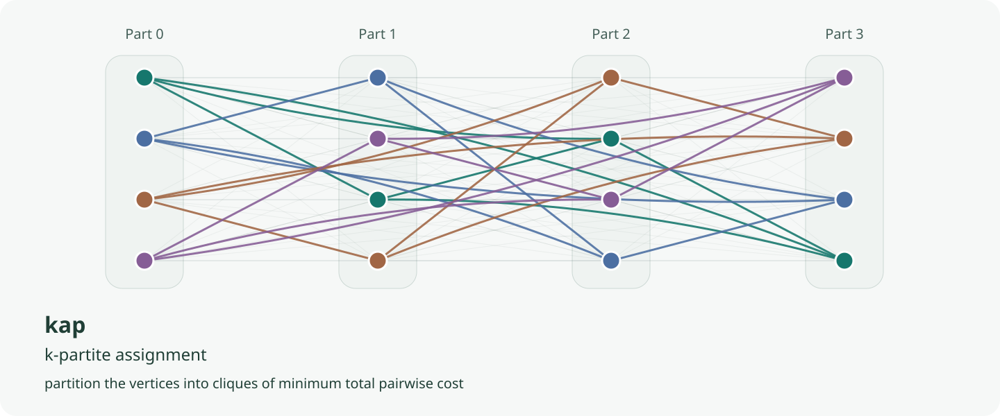

# Overview



`kap` provides Python and Rust solvers for k-partite assignment from pairwise cost matrices. It includes heuristic searches, an optimum bound for equal-size parts, and a linear assignment solver; Python also provides an exact MILP solver.

## Problem

Let V₀, …, Vₖ₋₁ be disjoint parts. For each i &lt; j, Cᵢⱼ[u,v] gives the cost of pairing vertex u in Vᵢ with vertex v in Vⱼ. A solution partitions the vertices into N = maxᵢ |Vᵢ| cliques, counting singletons, with at most one vertex from each part in each clique.

For a clique Q, define its cost as:

<p><code>cost(Q) = Σ<sub>i&lt;j; (i,u),(j,v)∈Q</sub> Cᵢⱼ[u,v]</code></p>

The objective is:

<p><code>minimize Σ<sub>Q in the partition</sub> cost(Q)</code></p>

Use maximization for weights instead of costs. Equal-size parts give full k-vertex cliques; unequal sizes can leave parts absent from a clique or produce free singleton vertices.

## Which function

| Need | Function | When |
|---|---|---|
| Default heuristic search | `ils` / `Algo::Ils` | Use `time_limit` and several chains for quality; measured 1 s runs with eight chains reached the proven optimum on all 33 small benchmark instances. |
| Original multiple Hungarian methods | `multiple_hungarian` / Am–Fm | Reproduce the paper's methods; Am, Dm, and Shift limit construction work, while Bm-based methods grow rapidly with k. |
| Refine a complete solution | `local_search` / DV | Apply deterministic 1DV or sDV sweeps, with a constructed start or a supplied complete solution. |
| Population search | `memetic` / `Algo::Memetic` | Compare mutation and crossover with ILS on your instances; measured multi-chain ILS costs were lower or equal at 60 s. |
| Choose a method by name | `k_assignment` | Retain a common Python dispatcher or select an explicit Rust `Algo`. |
| Prove an optimum | `exact` (Python only) | Use small equal-size inputs, with about 10⁵ tuple variables as a practical limit. |
| Bound the remaining improvement | `lower_bound` | Measured k=3 and metric-cost gaps were small; random costs at k≥4 gave looser bounds. |
| Solve a two-part LAP | `linear_sum_assignment` | Compute an optimal rectangular linear assignment. |

See the [benchmarks](benchmarks.md) for instance definitions, hardware, timings, and gaps.

## Minimal example

<div class="lang-tabs">

```python
{{#include ../examples/overview.py}}
```

```rust
{{#include ../../../crates/kap-solver/examples/doc_overview.rs}}
```

</div>

Python output:

```text
{{#include ../examples/overview.python.txt}}
```

The Rust example prints the same cliques and costs in the same format.

## Reference

B. Gabrovšek, T. Novak, J. Povh, D. Rupnik Poklukar, and J. Žerovnik, “Multiple Hungarian Method for k-Assignment Problem,” *Mathematics* 8(11), 2050, 2020. [doi:10.3390/math8112050](https://doi.org/10.3390/math8112050).
